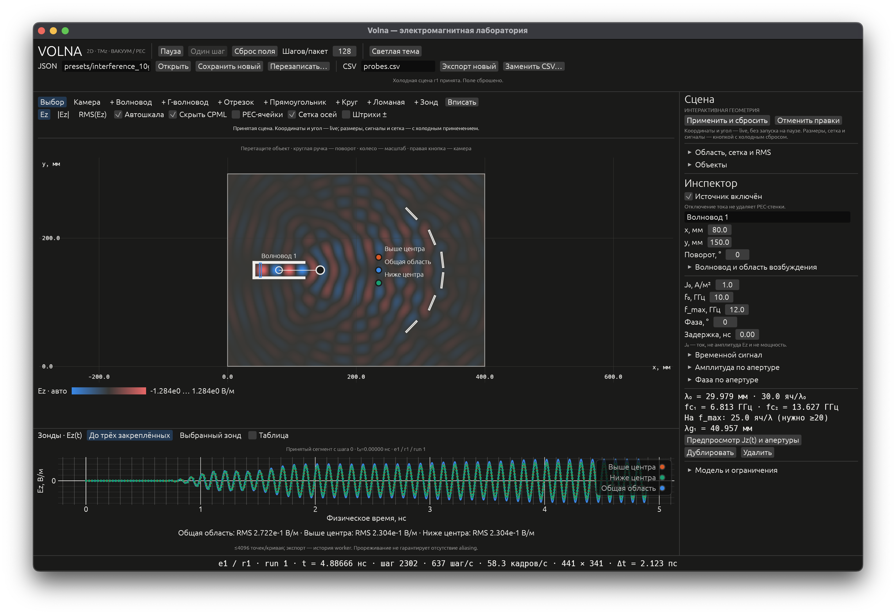

# Volna

**Интерактивная электромагнитная лаборатория на Rust.**

Перемещайте волноводы и отражатели, наблюдайте интерференцию в реальном времени и измеряйте поле зондами — в нативном окне, без браузера и сервера.

[](https://github.com/petara94/volna/actions/workflows/ci.yml)


[Быстрый старт](#быстрый-старт) · [Примеры](#готовые-сцены) · [Управление](docs/usage.md) · [Численная модель](docs/numerics.md) · [Проверки](docs/validation.md)



*Настоящий снимок нативного приложения. Волновод 10 ГГц, шесть наклонных PEC-рёбер и три зонда в общей области интерференции.*

## Что можно делать

- **Редактировать на лету.** Переносить и вращать волноводы и отражатели без обнуления поля, времени и фазы источника. На паузе перемещение не запускает расчёт.
- **Собирать геометрию.** Прямые и Г-образные волноводы, отрезки, прямоугольники, круги и ломаные. Новые объекты сразу видны как пунктирный черновик до принятия сцены.
- **Задавать возбуждение.** Несколько источников, CW, Gaussian, формулы и таблицы; независимые амплитуда и фаза по апертуре.
- **Наблюдать и измерять.** Карты Ez, |Ez| и RMS(Ez), физические единицы, авто/ручная шкала, графики и таблица зондов.
- **Сохранять результаты.** JSON-сцены и CSV измерений с параметрами запуска и отметкой унаследованного поля после live-правок.

Расчёт: **Yee FDTD · CPML · CPU · f64**. Интерфейс: **eframe/egui · wgpu**. GPU отображает поле; численное ядро работает отдельно от UI.

## Быстрый старт

### Из исходников

Нужны Rust **1.96.1** и графическая среда, поддерживаемая `wgpu`. Версия закреплена в `rust-toolchain.toml`, зависимости — в `Cargo.lock`. При использовании rustup первый запуск может загрузить закреплённый toolchain и зависимости.

```bash
git clone https://github.com/petara94/volna.git
cd volna
cargo run --release --locked
```

Откроется сцена с интерференционными рёбрами. Быстрый режим включён по умолчанию: до **128 шагов на пакет**, с ограниченным временем обработки пакета. Для интерактивной работы используйте **release**, а не `dev`.

```bash
# Г-образный канал
cargo run --release --locked -- --scene presets/waveguide_bend_10ghz.json

# Усреднённая карта интерференции
cargo run --release --locked -- --scene presets/interference_10ghz.json --view rms

# Параметры запуска без открытия окна
cargo run --release --locked -- --help
```

После сборки можно запускать `target/release/volna` напрямую. API-ключи, облачные сервисы и сервер не нужны.

### Готовая сборка

В [Releases](https://github.com/petara94/volna/releases) доступна предварительная сборка для **macOS / Apple Silicon** с примерами сцен. Распакуйте архив и из его каталога запустите `./volna`.

Сборка не нотарифицирована Apple. Если политика macOS запрещает запуск скачанного исполняемого файла, предпочтительный вариант — собрать приложение из исходников. Нативная работа проверялась на macOS 15.6; это не заявление о проверке всех ОС и GPU.

## Готовые сцены

| Сцена | Что показывает | JSON |
|---|---|---|
| Интерференционные рёбра | Шесть разнесённых отражателей и три зонда; стартовый пример | [interference_10ghz.json](presets/interference_10ghz.json) |
| Г-образный волновод | Поворот канала на 90°, открытый выход и два зонда | [waveguide_bend_10ghz.json](presets/waveguide_bend_10ghz.json) |
| Прямой волновод | Простой исходный пример без дополнительных отражателей | [waveguide_10ghz.json](presets/waveguide_10ghz.json) |

Все примеры начинают с 10 ГГц — это пресеты, **не фиксированная частота модели**. Параметры доступны в инспекторе. Сцену можно открыть через `--scene` или поле **JSON** в окне.

## Управление за минуту

1. Выберите **«+ Волновод»**, **«+ Г-волновод»** или отражатель, затем щёлкните в поле. Пунктир показывает ещё не принятую геометрию; сообщение поясняет результат применения.
2. Перетащите объект левой кнопкой. Круглая ручка отвечает за поворот. Положение и угол применяются без сброса.
3. Размеры, форму, сетку и сигнал изменяйте в инспекторе, затем нажмите **«Применить и сбросить»**.
4. **«Пауза»**, **«Один шаг»** и **«Сброс поля»** позволяют исследовать переходный процесс.
5. Добавьте зонды, выберите Ez/|Ez|/RMS и экспортируйте измерения в CSV.

Колесо меняет масштаб, правая/средняя кнопка перемещает камеру, **«Вписать»** возвращает общий вид. Полное руководство: [docs/usage.md](docs/usage.md).

## Границы модели

> Это самостоятельная **двумерная TMz-модель**: Ez, Hx, Hy, вакуум и идеальные проводники PEC. Она не является произвольным срезом реального 3D-устройства.

- **Нет потерь внутри вакуума и PEC.** CPML поглощает волну только на внешних границах. Уже отражённое поле не исчезает при переносе отражателя; CW продолжает вносить энергию. Долгая рябь не обязательно означает ошибку.
- **Live-редактирование — не движущийся металл.** Доплер, механическая работа и сохранение энергии через изменение маски не моделируются. Для независимого расчёта новой статической сцены выполните явный сброс.
- **Нет диэлектриков, потерь металла, 3D-портов и S-параметров.** J₀ — плотность тока, не мощность и не заданная амплитуда Ez.
- **JSON — не checkpoint.** Он сохраняет сцену, но не поля и историю движения. Конечный JSON сам по себе не воспроизводит переходное поле после live-правок.

Подробнее: [модель сцены](docs/model.md), [численная схема и источники](docs/numerics.md), [фактически выполненная верификация](docs/validation.md).

## Разработка и проверки

```bash
cargo fmt --all -- --check
cargo clippy --workspace --all-targets --locked -- -D warnings
cargo test --workspace --locked
cargo test --workspace --release --locked

# Ядро без GUI
cargo test --workspace --no-default-features --locked
```

CI проверяет численное ядро на Linux и сборку приложения на macOS. Его фактический статус показан в badge вверху. Более дорогие приёмочные опыты помечены `ignored` и запускаются отдельно; обычные тесты не выдают их за выполненные.

```text
src/model/     Сцена, геометрия и валидация входов
src/solver/    Yee, CPML, RMS и численные тесты
src/runtime.rs Вычислительный поток и экспорт
src/ui/        Нативный редактор, карты поля и графики
presets/       Воспроизводимые стартовые сцены
tests/         Геометрия, физика, файлы и live-протокол
```

[История изменений](CHANGELOG.md) · [Сообщить о проблеме](https://github.com/petara94/volna/issues)
